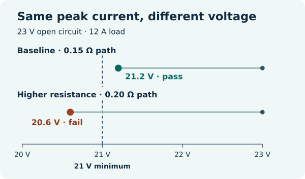

# Mobile Robot Battery Sizing in Python

Can a battery have enough watt-hours and still let the robot reset when it starts moving? This offline lab uses a mission energy budget and a separate voltage sag screen to show how that happens.

Read the full lesson and diagrams at [WIFA Robotics](https://wifarobotics.com/learn/mobile-robot-battery-sizing/).

## Get started

1. Install a supported Python 3.11 or newer from [Python.org](https://www.python.org/downloads/). Confirm with `python3 --version`; on Windows use `py -3 --version` and replace `python3` with `py -3` below.
2. Select **Code → Download ZIP** on this repository and extract the archive. Open a terminal in the extracted folder containing `battery.py`. Alternatively, clone this repository using Git and change into its directory.
3. Run these commands. No pip packages or equipment are needed for the calculator or tests.

```sh
python3 battery.py examples/baseline.json
python3 battery.py examples/sag-limited.json
python3 battery.py examples/energy-limited.json
python3 -m unittest discover -s tests -v
```

| Example | Mission energy | Available after reserve | Load voltage | Result |
| :-- | --: | --: | --: | :-- |
| baseline | 90.00 Wh | 103.68 Wh | 21.20 V | Both pass |
| sag-limited | 90.00 Wh | 103.68 Wh | 20.60 V | Voltage fails |
| energy-limited | 90.00 Wh | 86.40 Wh | 21.20 V | Energy fails |

All three scenarios use a 120 minute mission, 45 W average at the battery terminals and a 21 V minimum at the load. A valid calculation exits 0 even if a screen fails; exit 2 means the scenario could not be read or validated. Values are displayed to two decimal places; comparisons use unrounded values.

## Make your own input

Copy an example. Keep the JSON keys and use numbers without quotes.

| Field | Meaning |
| :-- | :-- |
| `phases[].minutes`, `phases[].average_w` | Duration in minutes and average electrical power at the pack terminals, including all devices and conversion losses once. Phases are sequential; simultaneous loads belong in one phase total. |
| `pack.nominal_v`, `pack.capacity_ah` | Nameplate values for the same pack; their product approximates nominal watt-hours if no rated Wh is available. |
| `pack.usable_fraction` | Fraction of nominal energy assumed available under your conditions before setting aside a mission reserve. |
| `pack.reserve_fraction` | Fraction of that usable energy held back from the planned mission. Enter 0.10 for 10%. |
| `peak.open_circuit_v` | Assumed pack voltage before the load at the relevant state of charge and temperature. This is not the nominal voltage field. |
| `peak.current_a` | Assumed total current through the modeled path during the peak. |
| `peak.path_ohm` | Lumped pack internal and supply path resistance to the modeled load, in ohms. Enter 0.15 for 150 mΩ. |
| `peak.min_load_v` | Minimum voltage the modeled device needs at its input for the relevant event. |

Energy is the sum of watts times hours. The budget is nominal Wh times usable fraction times one minus reserve fraction. Estimated load voltage is open circuit voltage minus current times path resistance. The two screens do not compute a discharge curve or combine into a runtime guarantee.

If Python cannot open a file, change into the folder with `battery.py` and use the commands above. If energy looks implausible, check watts versus watt-hours and minutes versus hours. If the voltage output is outside the model, check milliohms and the assumed current. A pack may show a voltage pass while tripping a current limit; the program has no model of battery protection.



## Bench boundary

The JSON scenarios are invented. The program does not model cell imbalance, surge duration, regulator dynamics, regeneration, pack protection or wiring temperature. It does not choose a chemistry, charger, fuse or cable. For real sizing use a qualified, documented pack and review its operating limits, including peak duration, temperature, state of charge, the controller input range and protection behavior. Use existing measurements from approved equipment to replace the illustrative inputs.

The tests cover numerical boundaries, invalid input, CLI behavior and 160 deterministic comparisons against exact rational arithmetic. Editable diagram sources are in `images/`. Optional diagram regeneration uses Inkscape and Pillow with WebP support: `python3 images/render.py`. Those tools are unnecessary for the lesson examples.

References: [TI on terminal voltage under load](https://www.ti.com/lit/an/slva194/slva194.pdf), [Victron technical data showing separate ratings](https://www.victronenergy.com/media/pg/Lithium_NG_battery_25,6_V/en/technical-data.html), and [Python unittest discovery](https://docs.python.org/3.12/library/unittest.html).
